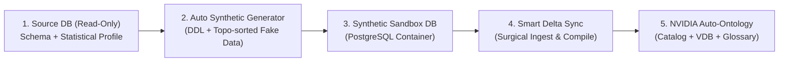

# Kế hoạch Triển khai & Kiểm thử Tự động (Auto-Ontology Lab)

Tài liệu tóm tắt yêu cầu kiến trúc tự động hóa luồng **Live Source DB $\rightarrow$ Synthetic Sandbox DB $\rightarrow$ NVIDIA Auto-Ontology**, cơ chế **Smart Incremental & Semantic Evolution**, và **8 Test Suites** đánh giá hệ thống.

---

## 1. Kiến trúc Mục tiêu: End-to-End Automated Synthetic & Ontology Pipeline

Thay vì tạo file `schema.sql` / `seed.sql` thủ công bằng prompt, hệ thống sẽ kết nối trực tiếp vào Database gốc ở chế độ Read-only, tự động sinh/cập nhật Database Synthetic ẩn danh, rồi đồng bộ sang NVIDIA Auto-Ontology:

### Ba phân hệ cần triển khai (`scripts/`)

1. **Tầng 1 — Live Schema & Distribution Introspector (`source_introspector.py`)**:
   - Kết nối Read-only tới `SOURCE_DB_URL` (PostgreSQL).
   - Tự động loại bỏ các bảng kỹ thuật (`schema_migrations`, `audit_logs`, `outbox`, `sessions`...).
   - Trích xuất DDL (Tables, Columns, PK, FK, Unique, Check, Views, RLS) và **chỉ thu thập thống kê phân phối** (tỷ lệ NULL, min/max, độ dài chuỗi, các giá trị enum/categorical có cardinality thấp, tỷ lệ dòng con/cha) — tuyệt đối không sao chép dữ liệu PII thật.

2. **Tầng 2 — Incremental Synthetic Database Generator (`synthetic_generator.py`)**:
   - Khởi tạo hoặc áp dụng `ALTER TABLE` (diff schema) sang database trung gian `<db>_synthetic` trong container PostgreSQL của Auto-Ontology.
   - Sắp xếp thứ tự bảng theo đồ thị phụ thuộc khóa ngoại (Topological Sort) và sinh dữ liệu giả lập deterministic (`Faker` + phân phối thống kê) đảm bảo 100% ràng buộc PK/FK/Check và cô lập đa tổ chức (multi-tenant).
   - Hỗ trợ **Incremental Mode**: Khi DB gốc thêm bảng/cột hoặc xuất hiện giá trị enum mới, chỉ cập nhật DDL và bơm bổ sung dữ liệu synthetic cho phần thay đổi (Delta).

3. **Tầng 3 — Smart Delta Evolution & Surgical Sync (`smart_evolve.py`)**:
   - Khắc phục điểm nghẽn hiện tại của Auto-Ontology (vốn bỏ qua bảng đã có `Term` trong `fetch_all_tables_without_term` và coi `RENAME COLUMN` là xóa + thêm mới):
     - **Auto-Rename Migration**: Tự động phát hiện cột đổi tên (dựa trên `ordinal_position`, `data_type`, `sample_values` và độ tương đồng tên) để chuyển nguyên vẹn `ColumnAttribute`, mô tả đã `certified` và `SEMANTIC_FK` sang cột mới (~0.5s, không cần gọi lại LLM).
     - **Surgical Column Compile (`ADD COLUMN`)**: Tự động phát hiện cột mới trên bảng đã có `Term`, lấy mẫu `sample_values`, sinh `ColumnAttribute` hoặc `SEMANTIC_FK` cho riêng cột mới và re-embed lại đúng `Term` đó (~3–5s thay vì 60 phút).
     - **Orphan Attribute Cleanup (`DROP COLUMN`)**: Tự động dọn các `ColumnAttribute` mồ côi khi cột vật lý bị xóa để tránh LLM sinh SQL lỗi.
     - **Incremental Data Profiling**: Tự động cập nhật `sample_values` và vector khi phát hiện giá trị phân loại (enum/status) mới trong dữ liệu.

---

## 2. Bộ 8 Test Suites Đánh giá Hệ thống

| # | Test Suite | Nội dung kiểm thử | Metrics chính | Trạng thái & Yêu cầu chuẩn bị |
| :-: | :--- | :--- | :--- | :--- |
| **1** | **Ontology Discovery** | Phát hiện entities, relationships, joins và business terms | Precision, Recall, F1 | Đối chiếu `term`, `column_attribute`, `column__semantic_fk` với ground-truth trong `manifest.json`. |
| **2** | **Text-to-SQL** | Schema-only vs Ontology-grounded | Execution Accuracy, $\Delta$ Accuracy | Chạy cùng tập câu hỏi trên Raw DDL prompt so với API/MCP của Auto-Ontology. |
| **3** | **Semantic Understanding** | Cột ngày dễ nhầm, business metrics, nhiều JOIN | Accuracy theo từng nhóm | Kiểm thử trên các cột thời gian dễ nhầm (`issued_at`/`due_date`/`voided_at`), logic tài chính (`void`, `reversal`) và chuỗi JOIN 4–6 bảng. |
| **4** | **Schema Evolution** | Add/rename/drop columns, thay FK, đổi định nghĩa | Detection rate, Update latency | Chạy kịch bản `ALTER TABLE` tự động qua `smart_evolve.py`, đo tỷ lệ nhận diện và độ trễ cập nhật tầng Catalog + Semantic. |
| **5** | **Continuous Learning** | Query logs, user corrections, certified definitions | Retention rate, Improvement | Bổ sung `sql_query`, Business Rules (`/api/rules`), SQL Attributes (`/api/sql-attributes`) và Certified Terms, đo mức tăng độ chính xác. |
| **6** | **Reliability** | Câu hỏi mơ hồ, thiếu dữ liệu, SQL không hợp lệ | Abstention quality, Error rate | Kiểm thử các trường hợp biên (môn không có subskill, buổi học `cancelled`, hoặc khái niệm ngoài schema). |
| **7** | **Performance** | Ingestion, compilation, SQL generation, execution | P50/P95 latency, Cost | Thu thập từ `semantic_compilation_history`, `frontend.conversation_analytics` và thời gian phản hồi thực tế. |
| **8** | **Security & Governance** | Tenant isolation, PII, quyền truy cập dữ liệu | Leakage rate, Policy violations | Bật `pii_detection_enabled = true`, kiểm thử phân quyền Zones/Groups và cô lập dữ liệu multi-tenant (`RLS` / `org_id`). |
