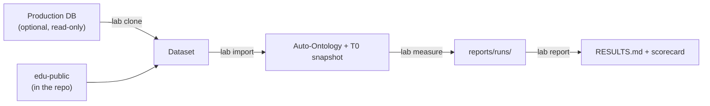

# Auto-Ontology Lab — Master Plan

> Entry point of the repository, and the authority wherever other docs disagree. Three steps: **prepare, measure, report**. Technical evidence is in `docs/UPSTREAM_ARCHITECTURE.md` and `docs/FINDINGS.md`; results are in `reports/RESULTS.md`.

## Summary

Load a synthetic database into NVIDIA Auto-Ontology and measure **ontology discovery accuracy**, **Text-to-SQL accuracy** and **schema evolution resilience**, first on unmodified upstream and then with the lab's sidecar patch. The result is a report anyone can reproduce, plus a scorecard tied to the exact versions measured.



| You want to | Run | You provide |
|---|---|---|
| Measure the public benchmark | `import`, `measure`, `report` | Running stack, tokens, model keys |
| Measure your own database | `clone`, then the same three | Also: read-only DSN, reviewed allowlist, your own `questions.json` |

## Principles

1. **Production path only.** Clients use the gateway (`:3000` + `x-api-key`). The one exception is `:3002/ingest` and `:3002/semantic/reset` inside `evolve`, which have no public route. The report says so.
2. **Vanilla first.** Patch numbers never appear without their vanilla baseline, and the scorecard records which is which in a required field.
3. **Pin everything.** Upstream commit, models and flags live in `config/freeze.yaml`. No `git pull` during a measurement.
4. **Always start from T0.** Restore both the catalog and the target database before each measurement. Never restart services between stages, because boot runs a pass.
5. **Healthy runs only.** No headline number if any result is missing or over 5% of questions hit infrastructure errors. A rate-limited run looks exactly like a weak model.
6. **Report the noise.** At least 3 runs for anything using an LLM, with `mean ± std` and per-question flips.
7. **Private data stays private.** Datasets, snapshots and scorecards from internal databases stay gitignored. Only `edu-public` is published.

## Step 1 — Prepare: `lab clone` + `lab import`

```powershell
python -m lab doctor
python -m lab clone --from-env LAB_SOURCE_DSN --to-env LAB_TARGET_DSN --out datasets/<name> --scale 0.1 --seed 42   # own database only
python -m lab import --dataset <name> [--drop]
python -m lab ask --probe --dataset <name>
```

- **Clone** turns a production database into a synthetic one with the same schema and comparable distributions, and no production values. Text values are never read. Categorical values come only from enums, `CHECK ... IN` literals or a human-reviewed allowlist. CHECKs that cannot be satisfied are dropped and reported as degraded (exit 2), which counts only after a reviewer acknowledges the list. Spec: [`docs/STEP1_CLONE_PLAN.md`](docs/STEP1_CLONE_PLAN.md).
- **Import** loads the dataset, registers it through the gateway as `lab_ro`, waits for ingest and compilation to really finish, and saves the T0 snapshot of both catalog and target.
- **`edu-public`** is the output of `lab clone` on an original schema of 15 tables modelled on common LMS concepts, committed to the repo with its questions and mutations. `lab measure --check-gold` verifies its gold SQL with no LLM.
- **Done when:** clone passes A1–A13, on a real internal database as well as the fixture. `lab import` loads, registers, compiles and snapshots on the live stack, and a re-run after a stopped pass recovers. `edu-public` is committed.

## Step 2 — Measure: `lab measure`

```powershell
python -m lab measure --dataset <name> [--only discover|ask|evolve|audit] [--patch]
```

Each suite restores T0 first and writes raw results to `reports/runs/<ts>/`. Without `--only`, all suites run in the order below.

**Before measuring,** `lab ask --probe` must return valid SQL for all 5 questions at a speed that makes the full run feasible. It exercises the chat path, not the import.

**Input checks.** Every run restores T0, then stops unless row counts match the dataset, the catalog holds every table, and the catalog's foreign key columns match the database. A run also fails the health check if agent steps fail on over 5% of answers, because the agent then continues on defaults and can still return plausible SQL (`docs/FINDINGS.md` F5).

### `discover`: was the ontology found correctly?

Export the model through `POST /api/model/export`, sort the relationship lists, read `certified` flags and synonyms from `/api/terms`, `/column-attributes` and `/api/sql-attributes`, and diff against `manifest.json`.

- **Output:** precision, recall and F1 for entities and for relationships (physical FK and semantic FK separately). A list of invented relationships. Recall for business terms when the manifest's `semantic` section is filled in, matched by executing the SQL; there is no precision here because upstream legitimately generates attributes nobody listed.

### `ask`: are the answers right?

Each question in `questions.json` has an executable gold SQL. Three modes: `ddl`, `ddl+meta`, and `gateway` (`POST /api/chat/completions`, sequential, viewer token). Gold and predicted SQL both run as `lab_ro`, and result sets are compared. Questions whose gold returns nothing are excluded.

- **Scope:** 60 questions on `edu-public`, 10 for each of `simple`, `join`, `metric`, `ambiguous_date`, `soft_delete` and `no_fk_join`; 20–30 for other databases.
- **Output:** accuracy by mode and category, flips, P50 and P95 seconds per question, a failure taxonomy, and every failed question with its SQL.
- **Limit to state in the report:** at 70% accuracy the standard error is about 6 points overall and about 14 points per category, so category numbers are directional only.

### `evolve`: does it survive schema change?

Mutations: `m01` rename a column with an FK, `m02` add a column, `m03` drop a column, `m04` retype, `m05` change a comment, `m06` promote a semantic FK to a physical FK, `m07` new enum value, `m08` new table (positive control).

For each mutation: restore T0, apply 3 certifications and 3 content edits, run 10 probes, apply the mutation, then run each stage below. **T2** is `:3002/ingest`, **T3** enables compilation with `PUT /api/configurations/semantic-compilation` (the gateway has no trigger route), **T4** is `:3002/semantic/reset?database_name=`.

| Check | When | Uses LLM to judge? |
|---|---|---|
| Export, diff, 6 edits survived | T2, T3, T4 | No |
| 10 probes | Before, T3, T4 | Yes |

Automatic detection is not tested by waiting: the 24h scheduler is hardcoded and no re-ingest API exists (`UPSTREAM_ARCHITECTURE.md` §0.5), so the report cites the code.

- **Vanilla expectation, from source:** `m01`–`m05` are not reflected at T2 or T3. T4 reflects them and destroys all 6 edits.
- **Output:** 8 mutations × 3 stages: reflected correctly, missing or wrong; edits kept out of 6; latency; probes that regressed.

### `--patch`: can a sidecar fix it?

Run only after the vanilla matrix is saved. `patch/smart_evolve.py` runs out of process against the pinned commit, with no upstream fork. It starts with the two behaviours that need no LLM:

- **Rename migration:** detect renames by position, type, name similarity and sample overlap, then move attributes, semantic FKs, descriptions and `certified` flags. Precision is measured on 10 true renames and 5 drop-then-add cases.
- **Orphan cleanup:** remove attributes and embeddings whose columns were dropped.

Surgical column compile (`m02`) and enum re-profiling (`m07`) are added only if the vanilla results show they matter.

### `audit`: two short checks

- **Unanswerable questions:** 20 out-of-schema questions through `/api/question-entity-coverage` and chat. Does it abstain, or invent SQL? Source suggests it invents SQL.
- **PII:** enable `pii_detection_enabled`, re-ingest, and check whether raw email and phone samples remain in `catalog_column.sample_values` and `vdb.semantic_layer`. Source suggests they do.

**Done when:** all suites ran healthy on `edu-public` for vanilla, and `evolve` also for patch.

## Step 3 — Report: `lab report`

```powershell
python -m lab report
```

- **`reports/RESULTS.md`:** freeze table, all suite results, vanilla and patch side by side, and every failure with its SQL. Raw metrics only, with no weighted overall score.
- **`scorecards/<upstream commit>/<dataset>@<hash>/<model>/<date>.json`:** append-only, and the key includes everything that can change a score.
- **Exit codes:** `0` complete, `1` tool failure, `3` a run failed the health check. A separate code for "regression" comes only once real flip data shows what counts as one.
- **Done when:** a second person can reproduce `edu-public`'s report from a clean clone with `git clone`, `uv sync`, the stack and their own keys.

## Decisions

- **Form:** a clone-and-run CLI. No PyPI package, MCP server or plugin system for now; `lab clone` stays inside the CLI with a clean module boundary so it can split later. 
- **Regression checks:** pull requests run only checks with no LLM. Scorecards run on a deliberate pin bump, not on every upstream commit. Comparing a bump against a stored scorecard is advisory until noise is measured; the stronger option is re-running the old pin alongside the new one, at twice the cost.
- **Pins:** the stack pins `c447003f`. The evolution patch targets exactly that commit.
- **LLM proxy:** chat models reach the hosted endpoint through `lab/proxy/llm_proxy.py`, because upstream's structured output fails there (issue #440, `docs/FINDINGS.md` F2). It changes the request format only, and every result must disclose it. Remove it once upstream is fixed.
- **Cut from the earlier 7-step plan:**
  - NVIDIA harness parity run, because its internal flags are already documented from source
  - Query-log learning, because `_usage_score` always returns 0 upstream
  - Token proxy and latency appendix
  - 24h wait test
  - Patch ablation study
  - Weighted rubric
  - Required `hahlex-edu` run; it stays optional for `discover`
  - Multi-tenant zones and incremental sync (already dropped)

## Milestones

| # | Scope | Proof |
|---|---|---|
| 1 | Step 1 | Live `lab import` and probes pass; `edu-public` committed |
| 2 | `discover`, `ask` | Accuracy and F1 tables on `edu-public`, with real flip data |
| 3 | `evolve` vanilla | 8 × 3 matrix: the lab's central finding |
| 4 | `--patch`, `audit`, Step 3 | Side-by-side matrix, `RESULTS.md`, first scorecard |

**If behind schedule,** cut `audit` first, then shrink `--patch` to rename migration alone. **Never cut the vanilla baseline.**

## Reference

- [`reports/RESULTS.md`](reports/RESULTS.md): the current results, generated by `lab report`. Screenshots of the runs are in `reports/evidence/`.
- [`docs/FINDINGS.md`](docs/FINDINGS.md): upstream behaviour found while running the lab, each with how it was verified.
- [`docs/UPSTREAM_ARCHITECTURE.md`](docs/UPSTREAM_ARCHITECTURE.md): Auto-Ontology's real behaviour, with `file:line` references.
- [`docs/STEP1_CLONE_PLAN.md`](docs/STEP1_CLONE_PLAN.md): the `lab clone` spec and its acceptance checks A1–A13.
- [`config/freeze.yaml.example`](config/freeze.yaml.example): environment freeze template.
