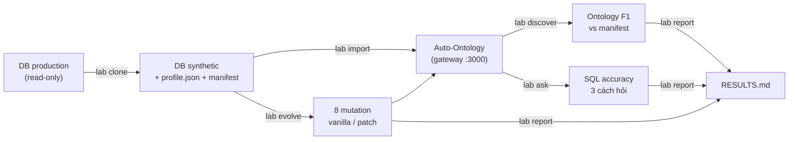

# Auto-Ontology Lab — Plan tổng

> File vào cửa của repo. Mỗi bước có một lệnh, một đầu vào, một đầu ra. Chi tiết từng bước nằm trong `docs/STEP*_*.md`; nền tảng kỹ thuật nằm trong `docs/UPSTREAM_ARCHITECTURE.md`.

## Một câu

Cắm một DB Postgres thật vào, sinh bản synthetic cùng schema cùng phân phối, đưa vào NVIDIA Auto-Ontology, rồi đo ba thứ: **ontology nó sinh ra đúng không**, **SQL nó viết đúng không**, **schema đổi thì nó có theo không** — trước và sau khi áp patch của lab.

## Nguyên tắc

1. Mọi client của lab gọi **gateway `:3000` + `x-api-key`** — đường production. Ngoại lệ duy nhất: `:3002/ingest` và `:3002/semantic/reset` trong `lab evolve`, vì không có đường public, và phải ghi rõ trong report.
2. **Vanilla trước, patch sau.** Không công bố số của patch mà không có số vanilla đặt cạnh.
3. Pin commit upstream, model, flag trong `config/freeze.yaml`. Không `git pull` trong suốt lab.
4. Snapshot/restore catalog DB trước mỗi bước đo. Không "chạy tiếp" trên trạng thái đã bẩn.
5. ≥ 3 lượt cho mọi số có LLM; báo mean ± std và số câu flip.
6. Dataset từ DB nội bộ gitignore. Ít nhất một dataset public (`edu-public`) commit để người khác tái lập.

## Các bước

### Bước 1 — `lab clone` · prod → synthetic
**Lệnh:** `python -m lab clone --from <prod ro url> --to <local url> --out datasets/<name> --scale 0.1 --seed 42`
**Đọc từ prod:** DDL + aggregate (count, null, distinct, min/max) + phân phối categorical cho cột text ≤ 50 distinct không PII. Không một dòng thật.
**Ra:** `datasets/<name>/{profile.json, ddl/, data/*.csv, seed.sql, manifest.json, validate_report.json}` và DB đích đã nạp.
**Xong khi:** `validate` pass (FK 100%, null ±3pp, categorical L1 ≤ 0.10) trên `hahlex-edu`.
**Plan:** [`docs/STEP1_CLONE_PLAN.md`](docs/STEP1_CLONE_PLAN.md) — đã viết.

### Bước 2 — `lab import` · synthetic → Auto-Ontology
**Lệnh:** `python -m lab import --dataset <name> [--drop]`
**Làm:** refactor `scripts/import_dataset.py` hiện có: nạp `data/` thay `seed.sql`; chuyển mọi call sang `:3000` với token admin (`POST /api/connections/test`, `POST /api/connections`, `PUT /api/configurations/semantic-compilation`); bỏ ghi thẳng `frontend.configurations`; bỏ `ensure_clean_env` sang `lab doctor`; poll `GET /api/semantic-compilation/status` + bảng `semantic_compilation_history`; sau khi xong `pg_dump` catalog → `snapshots/T0_<name>.dump`.
**Ra:** connection đăng ký, compile xong, snapshot T0, `reports/runs/<ts>/import.json` (thời gian ingest/compile).
**Xong khi:** `lab import` → `lab ask --probe` 5 câu trả về SQL.
**Plan:** viết sau khi bước 1 chạy được; nhỏ.

### Bước 3 — `lab discover` · ontology sinh ra đúng không
**Lệnh:** `python -m lab discover --dataset <name>`
**Làm:** `POST /api/model/export` → YAML (sort `foreign_keys`, `joins`, `semantic_fks`); `GET /api/terms`, `/column-attributes`, `/api/sql-attributes` lấy cờ certified + synonyms; diff với `manifest.json`.
**Ra:** P/R/F1 cho entity, relationship (tách `fk` vs `semantic_fk`), term; danh sách quan hệ bịa (false positive).
**Cần tay:** `manifest.json` phần `semantic` (quan hệ ngầm, công thức) — tùy chọn; không có thì chỉ đo cấu trúc.
**Xong khi:** chạy trên `edu-public` và `hahlex-edu`, có bảng F1.

### Bước 4 — `lab ask` · SQL viết đúng không
**Lệnh:** `python -m lab ask --dataset <name> --questions questions.json --mode ddl|ddl+meta|gateway --runs 3`
**Làm:** mỗi câu có SQL chuẩn (đã execute được). Ba cách hỏi: LLM với DDL trần / LLM với DDL + mô tả cột / `POST /api/chat/completions` tuần tự với header `x-auto-ontology-source: lab`. Chấm: chạy cả hai SQL trên DB synthetic qua role read-only, so set kết quả.
**Ra:** % đúng theo cách hỏi × loại câu (simple, join, metric, ambiguous_date, soft_delete, no_fk_join); flip rate; failure taxonomy; latency từ `GET /api/analytics`.
**Tùy chọn:** chạy thêm harness `auto-ontology-eval` để đối chiếu với số NVIDIA — lưu ý harness bật knob production không có (`validate_sql_values`, `calculation_only`).
**Cần tay:** `questions.json` ~180 câu cho `edu-public`; 20–30 câu là đủ cho DB khác.
**Xong khi:** bảng 3 cách × loại câu, 3 lượt, `edu-public`.

### Bước 5 — `lab evolve` · schema đổi thì sao
**Lệnh:** `python -m lab evolve --dataset <name> [--patch]`
**Làm:** 8 mutation (`m01` rename cột có FK, `m02` thêm cột vào bảng đã compile, `m03` drop cột, `m04` retype, `m05` đổi COMMENT, `m06` thêm FK vật lý cho cặp vốn là semantic FK, `m07` thêm giá trị enum mới vào data, `m08` thêm bảng mới). Mỗi mutation: `restore(T0)` → certify 3 term + sửa 3 nội dung (description, sample_values, 1 sql attribute manual) → 20 câu probe → `ALTER` → **T2** `POST :3002/ingest` → **T3** `POST /api/semantic-compilation/trigger` → **T4** `POST :3002/semantic/reset?database_name=` → sau mỗi T: export + diff + probe + kiểm tra 6 chỉnh sửa còn/mất. T1 (tự phát hiện) ghi nhận là **không tồn tại**: scheduler 24h hard-code, không có public re-ingest; chạy một lần chờ qua 24h cho `m01` làm bằng chứng.
**Kỳ vọng vanilla (có bằng chứng code, `UPSTREAM_ARCHITECTURE.md` §2.2):** rename = drop+add; bảng có Term không compile lại → m01–m05 không được phản ánh ở T2/T3; T4 phản ánh nhưng **xoá sạch** 6 chỉnh sửa.
**Patch `--patch` (`patch/smart_evolve.py`, sidecar, không fork):** chạy sau `ALTER`, trước compile, đọc catalog DB + gọi ingestion API:
- *auto-rename*: phát hiện cột đổi tên bằng `ordinal_position` + `data_type` + tương đồng tên + sample overlap → chuyển `column_attribute`, `column__semantic_fk`, description, certified sang cột mới, giữ id Term;
- *surgical compile*: cột mới trên bảng đã có Term → profile riêng cột, sinh `column_attribute` hoặc `semantic_fk`, re-embed đúng Term;
- *orphan cleanup*: `column_attribute` mất cột vật lý → xoá kèm vector;
- *re-profile*: enum có giá trị mới → cập nhật `sample_values` + vector.
Mỗi hành vi một flag để đo ablation. Đo riêng **rename precision**: 10 rename thật + 5 drop-rồi-add-khác-nghĩa.
**Ra:** ma trận 8 mutation × (T2, T3, T4) × (vanilla, patch): phản ánh đúng / thiếu / sai; latency; 6 chỉnh sửa còn/mất; probe đúng→sai.
**Xong khi:** hai ma trận trên `edu-public`.

### Bước 6 — kiểm tra phụ (mỗi cái ≤ nửa ngày)
- **Unanswerable:** 30 câu về thứ không có trong DB + 10 câu mơ hồ → `POST /api/question-entity-coverage` lấy coverage; `POST /api/chat/completions` xem từ chối / bịa SQL / lỗi. Kỳ vọng: bịa, vì `sql_code` là NonEmpty và chat không gọi coverage.
- **PII:** bật `pii_detection_enabled`, ingest lại, kiểm `catalog_column.sample_values` cột email/phone và grep `vdb.semantic_layer`. Kỳ vọng: giá trị vẫn nằm đó, chỉ có tag.
- **Query log:** chạy 50 query trên DB synthetic ngay trước `:3002/ingest`, compile, đếm sql attribute mới; hỏi lại nhóm metric.
- **Token/cost:** proxy log trước `*_ENDPOINT`; latency từ analytics. Một bảng, không phân tích.

### Bước 7 — `lab report`
Sinh `reports/RESULTS.md` từ `reports/runs/`: bảng freeze; F1; accuracy 3 cách × loại; ma trận evolve vanilla/patch; unanswerable; phụ lục PII/log/latency; **mọi** failure case kèm SQL. Thêm scorecard theo định dạng ban đầu (Baseline vs Auto Ontology; bảng capability) và rubric 5 nhóm 25/20/20/20/15 — rubric là đánh giá của lab, metric gốc giữ nguyên để người khác tự chấm.

## Thứ tự và mốc

| Tuần | Làm | Mốc kiểm chứng |
|---|---|---|
| 1 | Bước 1, 2 | `lab clone` pass validate trên `hahlex-edu`; `lab import` ra YAML đầu tiên |
| 2 | Bước 3, 4 | F1 + bảng accuracy 3 cách trên `edu-public` |
| 3 | Bước 5 vanilla | Ma trận 8 × 3 vanilla |
| 4 | Bước 5 patch, 6, 7 | Ma trận patch, `RESULTS.md`, bài |

Trượt lịch: cắt query-log trước, rồi ablation patch, rồi dataset nội bộ. **Không cắt vanilla.**

## Quyết định đã chốt

- Stack lab pin `c447003f`; harness NVIDIA pin `dd78d068` — nếu không sửa pin được thì chạy riêng, ghi cả hai trong `freeze.yaml`.
- `edu-public` = **output** của `lab clone` chạy trên một schema LMS mở rút gọn (~15 bảng, data tự sinh), commit vào repo. Không viết YAML tay.
- Patch là sidecar ngoài process, tương thích với đúng commit đã pin. Không fork upstream.
- Bỏ tenant isolation (zones không còn là ranh giới phân quyền). Bỏ incremental sync prod → synth.

## Tài liệu

- [`docs/UPSTREAM_ARCHITECTURE.md`](docs/UPSTREAM_ARCHITECTURE.md) — Auto-Ontology thật sự làm gì, có file:line.
- [`docs/LAB_PLAN.md`](docs/LAB_PLAN.md) — chi tiết metric, protocol, rủi ro (tên "suite", "arm", "T0–T4" ở đó chỉ là nhãn tham chiếu).
- [`docs/STEP1_CLONE_PLAN.md`](docs/STEP1_CLONE_PLAN.md) — bước 1.
- [`config/freeze.yaml.example`](config/freeze.yaml.example).
