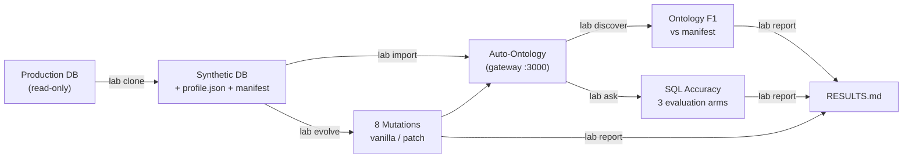

# Auto-Ontology Lab — Master Plan

> Entry point of the repository. Every step has a single command, a defined input, and a deterministic output. Detailed step-by-step plans reside in `docs/STEP*_*.md`; technical foundations are documented in `docs/UPSTREAM_ARCHITECTURE.md`.

## One-Sentence Summary

Connect to a live PostgreSQL database, generate a synthetic clone with matching schema and data distributions, import it into NVIDIA Auto-Ontology, and measure three dimensions: **ontology discovery accuracy**, **Text-to-SQL accuracy**, and **schema evolution resilience** — both before and after applying the lab's sidecar patch.

## Core Principles

1. Every lab client communicates exclusively via the **production gateway (`:3000` + `x-api-key`)**. The only exception is calling `:3002/ingest` and `:3002/semantic/reset` during `lab evolve` because no public endpoints exist for these operations — and this must be explicitly noted in the report.
2. **Vanilla first, patch second.** Never report patch metrics without presenting the corresponding vanilla baseline alongside them.
3. Pin the upstream commit, models, and runtime flags in `config/freeze.yaml`. Do not run `git pull` during the evaluation lifecycle.
4. Snapshot and restore the catalog database before every measurement phase. Never continue executing on a mutated or dirty state.
5. Run $\ge 3$ iterations for every LLM-dependent metric; report `mean ± std` as well as the question flip rate across runs.
6. Datasets derived from internal databases must remain gitignored. Commit at least one public dataset (`edu-public`) so third parties can reproduce the results.

## Pipeline Steps

### Step 1 — `lab clone` · Production $\rightarrow$ Synthetic
- **Command:** `python -m lab clone --from-env LAB_SOURCE_DSN --to-env LAB_TARGET_DSN --out datasets/<name> --scale 0.1 --seed 42`
- **Extracted from production:** DDL + numeric/date aggregates + text length/null statistics. No text values by default; categorical values only from enums, `CHECK ... IN` literals, or a human-reviewed allowlist (`--profile-only` prints candidates). Generation never connects to the source.
- **Engine:** chosen first by running candidates (seedgen as-is, wrapped by a Python adapter) through the acceptance suite; fallback is a Python generator. No Rust toolchain in the lab.
- **Outputs:** `datasets/<name>/{profile.json, ddl/, data/*.csv, manifest.json (with load_order and composite FKs), validate_report.json}` and a populated target DB with a read-only `lab_ro` role.
- **Done when:** acceptance checks A1–A10 pass (canary absent everywhere, all FKs incl. composite preserved, size-aware null/L1 thresholds, deterministic, importable into Auto-Ontology) — first on the in-repo fixture, then on a real internal database. Unsatisfiable CHECKs are dropped and reported as **degraded** (exit code 2), never silently.
- **Plan:** [`docs/STEP1_CLONE_PLAN.md`](docs/STEP1_CLONE_PLAN.md).

### Step 2 — `lab import` · Synthetic $\rightarrow$ Auto-Ontology
- **Command:** `python -m lab import --dataset <name> [--drop]`
- **Implementation:** Refactor the existing `scripts/import_dataset.py`: load `data/` CSVs instead of `seed.sql`; route all API calls through `:3000` using an admin token (`POST /api/connections/test`, `POST /api/connections`, `PUT /api/configurations/semantic-compilation`); remove direct SQL writes to `frontend.configurations`; extract `ensure_clean_env` into `lab doctor`; poll `GET /api/semantic-compilation/status` + the `semantic_compilation_history` table; take a `pg_dump` snapshot of the catalog database to `snapshots/T0_<name>.dump` upon completion.
- **Outputs:** Registered connection, completed semantic compilation, `T0` catalog snapshot, and `reports/runs/<ts>/import.json` (recording ingestion and compilation durations).
- **Done when:** `lab import` followed by `lab ask --probe` on 5 smoke-test questions returns valid SQL.
- **Plan:** To be drafted once Step 1 is operational; small scope.

### Step 3 — `lab discover` · Ontology Discovery Accuracy
- **Command:** `python -m lab discover --dataset <name>`
- **Implementation:** Call `POST /api/model/export` to retrieve the YAML model (sorting `foreign_keys`, `joins`, and `semantic_fks`); query `GET /api/terms`, `/column-attributes`, and `/api/sql-attributes` to fetch `certified` flags and synonyms; diff against `manifest.json`.
- **Outputs:** Precision / Recall / F1 for entities, relationships (broken down by physical `fk` vs. `semantic_fk`), and business terms; list of hallucinated relationships (false positives).
- **Manual input:** The `semantic` section of `manifest.json` (implicit relationships and business formulas) — optional; if omitted, only structural discovery is evaluated.
- **Done when:** Executed on both `edu-public` and `hahlex-edu`, producing a complete F1 comparison table.

### Step 4 — `lab ask` · Text-to-SQL Accuracy
- **Command:** `python -m lab ask --dataset <name> --questions questions.json --mode ddl|ddl+meta|gateway --runs 3`
- **Implementation:** Every question is paired with an executable gold SQL query. Evaluate across three modes: (1) LLM with raw DDL (`ddl`), (2) LLM with DDL + column descriptions (`ddl+meta`), and (3) sequential requests to `POST /api/chat/completions` with header `x-auto-ontology-source: lab` (`gateway`). Scoring executes both gold and predicted SQL against the synthetic DB via a read-only role and compares the result sets.
- **Outputs:** Execution accuracy (%) by evaluation mode $\times$ question category (`simple`, `join`, `metric`, `ambiguous_date`, `soft_delete`, `no_fk_join`); flip rate; failure taxonomy; latency extracted from `GET /api/analytics`.
- **Optional:** Also run the upstream `auto-ontology-eval` harness for direct comparison against NVIDIA's published methodology — noting that the harness enables internal knobs (`validate_sql_values`, `calculation_only`) unavailable in production.
- **Manual input:** `questions.json` containing ~180 questions for `edu-public` (20–30 questions suffice for additional databases).
- **Done when:** 3-mode $\times$ category accuracy table across 3 runs completed on `edu-public`.

### Step 5 — `lab evolve` · Schema Evolution & Resilience
- **Command:** `python -m lab evolve --dataset <name> [--patch]`
- **Implementation:** Run 8 schema/data mutations:
  - `m01`: Rename a column with an existing FK
  - `m02`: Add a column to an already-compiled table
  - `m03`: Drop a column
  - `m04`: Change a column's data type (retype)
  - `m05`: Update a column `COMMENT`
  - `m06`: Add a physical FK constraint to a pair previously linked as a `semantic_fk`
  - `m07`: Insert a new enum/categorical value into the data
  - `m08`: Create a new table
  
  For each mutation: `restore(T0)` $\rightarrow$ certify 3 terms + apply 3 content edits (`description`, `sample_values`, and 1 manual SQL attribute) $\rightarrow$ run 20 probe questions $\rightarrow$ execute `ALTER` $\rightarrow$ **T2** `POST :3002/ingest` $\rightarrow$ **T3** `POST /api/semantic-compilation/trigger` $\rightarrow$ **T4** `POST :3002/semantic/reset?database_name=` $\rightarrow$ after each stage (`T2`–`T4`): export + diff + run probes + check whether the 6 manual/certified edits survived. Stage **T1** (automatic background detection) is documented as **unsupported by design** (hardcoded 24h scheduler, no public re-ingest endpoint); a single 24h wait test is executed once on `m01` for empirical confirmation.
- **Vanilla expectation (backed by source code evidence in `UPSTREAM_ARCHITECTURE.md` §2.2):** Column rename is treated as drop + add; tables that already have an associated `Term` are never re-compiled $\rightarrow$ `m01`–`m05` are not reflected at `T2`/`T3`; `T4` reflects the schema changes but **wipes out all 6 certified/manual edits**.
- **Sidecar Patch `--patch` (`patch/smart_evolve.py`, out-of-process, no upstream fork):** Runs after `ALTER` and prior to compilation, reading the catalog DB and invoking the ingestion API:
  - *Auto-rename migration*: Detects renamed columns via `ordinal_position` + `data_type` + name similarity + sample overlap $\rightarrow$ migrates `column_attribute`, `column__semantic_fk`, descriptions, and `certified` flags to the new column while preserving the `Term` ID.
  - *Surgical column compile*: For newly added columns on tables that already have a `Term` $\rightarrow$ profiles the individual column, generates its `column_attribute` or `semantic_fk`, and re-embeds the parent `Term`.
  - *Orphan cleanup*: Removes `column_attribute` records and vector embeddings whose underlying physical columns were dropped.
  - *Incremental re-profile*: When a categorical/enum column acquires new distinct values $\rightarrow$ refreshes `sample_values` and updates its vector embedding.
  
  Each behavior is gated behind an independent CLI flag for ablation studies. **Rename precision** is evaluated separately across 10 true renames + 5 drop-then-add-unrelated-column cases.
- **Outputs:** An $8\text{ mutations} \times (\text{T2, T3, T4}) \times (\text{vanilla, patch})$ evaluation matrix tracking reflection accuracy (correct / missing / erroneous), latency, retention of the 6 manual edits, and probe regressions (pass $\rightarrow$ fail).
- **Done when:** Both vanilla and patch matrices are completed on `edu-public`.

### Step 6 — Supplementary Audits ($\le 0.5$ days each)
- **Unanswerable / Abstention:** 30 questions referencing out-of-schema concepts + 10 ambiguous questions $\rightarrow$ call `POST /api/question-entity-coverage` to record coverage scores; call `POST /api/chat/completions` to observe whether the agent abstains, hallucinates SQL, or errors out. Expectation: the agent hallucinates SQL because `sql_code` is typed as `NonEmptyStr` and the chat pipeline never invokes the entity coverage check.
- **PII Leakage:** Enable `pii_detection_enabled`, re-ingest, inspect `catalog_column.sample_values` on email/phone columns, and grep `vdb.semantic_layer`. Expectation: raw sample values remain unmasked in both the catalog and vector embeddings; PII detection only attaches a metadata tag.
- **Query Log Learning:** Execute 50 analytical queries against the synthetic DB immediately before calling `:3002/ingest`, trigger compilation, count newly synthesized SQL attributes, and re-run the `metric` question category.
- **Token Usage & Latency:** Place a logging proxy in front of `*_ENDPOINT` to count tokens; extract end-to-end latency from `GET /api/analytics`. Present as a single summary table without deep analysis.

### Step 7 — `lab report`
Generate `reports/RESULTS.md` automatically from `reports/runs/`: environment freeze table; ontology discovery F1; 3-mode $\times$ category SQL accuracy; vanilla vs. patch evolution matrices; abstention analysis; PII / query-log / latency appendices; and **every** failure case alongside its generated SQL. Include a summary scorecard (Baseline vs. Auto-Ontology capability matrix) and a 5-part weighted rubric (25/20/20/20/15) — keeping raw metrics primary so readers can apply their own weights.

## Schedule & Milestones

| Week | Scope | Verifiable Milestone |
|---|---|---|
| 1 | Steps 1, 2 | Engine decided; `lab clone` passes A1–A10 on the fixture, then on a real internal DB; `lab import` exports the first ontology YAML |
| 2 | Steps 3, 4 | Discovery F1 + 3-mode Text-to-SQL accuracy table on `edu-public` |
| 3 | Step 5 (vanilla) | $8 \times 3$ vanilla schema evolution matrix |
| 4 | Step 5 (patch), Steps 6, 7 | Patch evolution matrix, `RESULTS.md`, and final write-up |

**Schedule fallback order:** If behind schedule, cut the query-log test first, followed by the patch ablation breakdown, and finally internal dataset runs. **Never cut the vanilla baseline.**

## Finalized Architectural Decisions

- The lab runtime stack pins `c447003f`; NVIDIA's evaluation harness pins `dd78d068` — if updating the harness pin breaks compatibility, run the harness in an isolated environment and record both commit hashes in `freeze.yaml`.
- `edu-public` is generated as the **output** of `lab clone` executed against a streamlined open-source LMS schema (~15 tables with deterministically seeded data) and committed to the repository. No hand-written ontology YAML.
- The evolution patch runs as an out-of-process sidecar targeting the exact pinned upstream commit. Do not fork the upstream repository.
- Drop multi-tenant zone isolation testing (zones are no longer enforced as authorization boundaries upstream) and drop incremental production $\rightarrow$ synthetic data syncing.

## Reference Documentation

- [`docs/UPSTREAM_ARCHITECTURE.md`](docs/UPSTREAM_ARCHITECTURE.md) — Ground-truth behavior of Auto-Ontology with exact `file:line` references.
- [`docs/LAB_PLAN.md`](docs/LAB_PLAN.md) — Detailed metrics, experimental protocols, and risk mitigations (where labels such as "suite", "arm", and "T0–T4" serve as code reference identifiers).
- [`docs/STEP1_CLONE_PLAN.md`](docs/STEP1_CLONE_PLAN.md) — Step 1 implementation specification.
- [`config/freeze.yaml.example`](config/freeze.yaml.example) — Environment freeze template.
